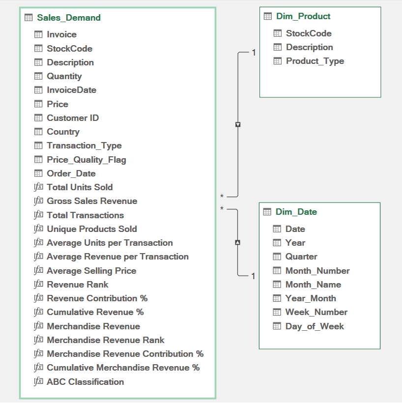
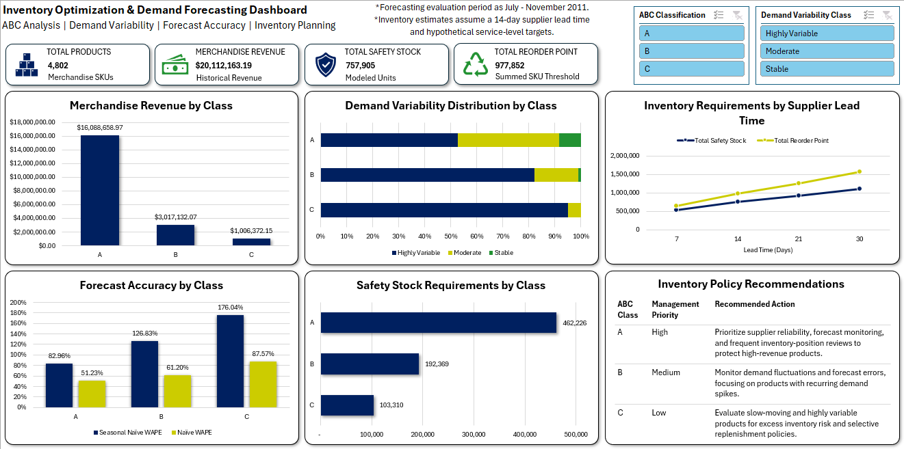

# Excel Project - Inventory Optimization & Demand Forecasting

## Project Overview
This project examines the challenges of balancing inventory availability, demand uncertainty, and excess stock for a fictional online retailer. Using over 1 million retail transaction records and analyzing 4,802 merchandise products, the project focuses on three primary objectives:
1. **Product Classification & Demand Analysis:** Classify products by revenue contribution and evaluate demand patterns across individual product classes and the overall merchandise portfolio.
2. **Demand Forecasting:** Compare multiple forecasting methods to identify the best-performing approach for predicting product demand.
3. **Inventory Planning:** Develop replenishment recommendations using modeled safety stock requirements, reorder points, and sensitivity analysis.

The completed project delivers an interactive Excel dashboard, key analytical findings, and actionable recommendations to support inventory planning and demand forecasting decisions.

## Tools & Technologies
**1. Excel:** Developed inventory planning calculations, sensitivity analyses, and the executive dashboard.  
**2. Power Query:** Cleaned, standardized, and transformed over 1 million retail transaction records.  
**3. Power Pivot:** Built the relational data model connecting sales, product, and date tables.  
**4. DAX:** Created custom measures for revenue analysis, product rankings, and demand analysis.  
**5. PivotTables:** Aggregated product classifications, inventory requirements, and analytical results.  
**6. PivotCharts:** Built interactive visualizations for inventory and demand analysis.  
**7. Slicers:** Enabled interactive dashboard filtering by ABC classification and demand variability.

## Dataset
The dataset used for this project is the Online Retail II dataset from the UCI Machine Learning Repository. It contains 1,067,371 transaction line records spanning December 2009 through December 2011. After data preparation and merchandise classification, 4,802 unique merchandise products were included in the final analysis.

The dataset contains historical sales transactions but does not provide actual inventory balances, supplier lead times, inventory holding costs, or stockout records. Therefore, inventory replenishment calculations rely explicitly on defined modeling assumptions.

## Data Preparation
Data preparation was performed primarily using Excel Power Query to clean, standardize, and transform the original Online Retail II dataset into structured tables suitable for analysis.

The preparation process included:

1. **Data Ingestion & Validation:** Imported and combined the two historical datasets containing 1,067,371 transaction line records. Validated data types, reviewed missing values, and identified negative quantities associated with returns and cancellations.

2. **Data Cleaning:** Filtered the transaction data to retain positive-quantity sales for demand analysis. Preserved records with missing Customer IDs because customer identification was not required for product-level demand forecasting.

3. **Product Standardization:** Standardized product descriptions using "StockCode" to address inconsistent naming and created a product dimension with unique product identifiers.

4. **Merchandise Classification:** Distinguished merchandise products from non-merchandise transactions, including adjustments and other accounting related entries. The final analytical scope contained 4,802 merchandise products.

5. **Data Modeling:** Created product and date dimension tables and established relationships within Power Pivot to support revenue calculations, product rankings, and time-based analysis.

6. **Monthly Demand Aggregation:** Aggregated sales quantities by product and month, including zero-sales months, to create a consistent monthly demand history for variability analysis and forecasting.

These transformations established a structured and consistent dataset for ABC classification, demand analysis, forecasting evaluation, and inventory replenishment modeling.

## Data Model
A relational data model was developed using Excel Power Pivot to connect transactional sales data with product and date dimensions. This structure supports revenue analysis, product classification, and time-based demand calculations.

The model includes:

**- Sales_Demand:** Transaction-level sales records used for revenue and unit-demand analysis.  
**- Dim_Product:** Unique product identifiers, standardized product descriptions, and merchandise classifications.  
**- Dim_Date:** Calendar dimension supporting monthly demand aggregation and time-based analysis.

Relationships were established between the sales table and the product and date dimensions to support consistent calculations across the model. You can see the data model from Power Pivot here:

## Analytical Methodology
This analysis required technical calculations to classify products, identify demand levels, and test different forecasting methods. The methodology used throughout the project can be divided into four subsections:

### 1. ABC Classification
The 4,802 products were classified using a traditional ABC analysis. Products were ranked by merchandise revenue and classified using the following cumulative revenue thresholds:  

**Class A:** Products contributing approximately the first 80% of cumulative merchandise revenue.  
**Class B:** Products contributing approximately the next 15% of cumulative merchandise revenue  
**Class C:** Products contributing approximately the bottom 5% of cumulative merchandise revenue

### 2. Demand Variability
Demand variability was divided into three categories using the coefficient of variation (CV).

$$
CV = \frac{\text{Monthly Demand Standard Deviation}}{\text{Average Monthly Demand}}
$$

The criteria for the three demand categories are here:

**Stable Demand:** CV < 0.50  
**Moderate Demand:** 0.50 <= CV < 1.00  
**Highly Variable Demand:** CV >= 1.00

### 3. Demand Forecasting
For this analysis I tested three forecasting methods: Naive, 3-Month Moving Average, and Seasonal Naive. Each method used the data from January 2010 through June 2011 as the training period to compare against the data in the testing period of July 2011 through November 2011. The primary comparison metric was the weighted absolute percentage error (WAPE), where a lower WAPE indicates a better method.

$$
WAPE = \frac{\sum|{\text{Actual units sold - Forecasted Units Sold}}|}{\sum{\text{Actual units sold}}}\times100\%
$$

### 4. Inventory Planning
To develop inventory replenishment recommendations, I assumed a fixed 14-day supplier lead time and established ABC-based service-level targets of 98% for Class A, 95% for Class B, and 90% for Class C products. These assumptions were used to calculate safety stock requirements and reorder points for each of the 4,802 merchandise products.

**Safety Stock**

$$
SS = Z \times \sigma_d \times \sqrt{L}
$$

Where:  
**Z** = Z-score corresponding to the ABC service-level target  
**$\sigma_d$** = Estimated daily demand standard deviation  
**L** = Supplier lead time in days

Daily demand standard deviation was estimated by dividing monthly demand standard deviation by the square root of 30, assuming a 30-day month and independent daily demand fluctuations.

**Reorder Point**

$$
ROP = (d \times L) + SS
$$

Where:  
**d** = Average daily demand, calculated as average monthly demand divided by 30  
**L** = Supplier lead time in days  
**SS** = Calculated safety stock

The reorder point represents the inventory position at which a replenishment order should be placed.

**Sensitivity Analysis**

To evaluate how inventory requirements change under different operating assumptions, I conducted two sensitivity analyses:

**- Suppler Lead Time:** Compared modeled inventory requirements under 7, 14, 21, and 30-day lead times.  
**- Service Levels:** Evaluated alternative ABC service-level targets to measure their impact on total safety stock requirements.

These calculations represent modeled inventory planning estimates rather than actual inventory levels or verified cost savings.

## Interactive Excel Dashboard

The interactive Excel dashboard provides management with a centralized view of inventory planning, product demand, and forecast performance.

At the top of the dashboard, four KPI cards display key metrics: **Total Products**, **Merchandise Revenue**, **Total Safety Stock**, and **Total Reorder Points**. Two interactive slicers allow users to filter selected dashboard metrics and visualizations by **ABC Classification** and **Demand Variability Class**.

Five charts provide additional insights into inventory performance:

**- Merchandise Revenue by ABC Class:** Illustrates how revenue is distributed across product classifications.  
**- Safety Stock by ABC Class:** Shows the modeled safety stock requirements for each product class.  
**- Demand Variability Distribution:** Breaks down demand variability classifications within each ABC class.  
**- Forecast Accuracy Comparison:** Compares SKU-level aggregated WAPE between Naïve and Seasonal Naïve forecasting methods across ABC classes.  
**- Inventory Lead-Time Sensitivity:** Demonstrates how total safety stock and reorder point requirements change under different supplier lead-time assumptions.

The dashboard also includes **priority-based inventory recommendations** for each ABC class, connecting the analytical findings to actionable management decisions.

## Key Findings
I have summarized this analysis into five main key findings:

**1. Revenue Concentration:** Class A products represent approximately 21% of all merchandise products but generate 80% of total merchandise revenue. This indicates that the business is highly dependent on a relatively small group of products, making their availability particularly important to management.

**2. Demand Uncertainty:** Of the 4,802 merchandise products analyzed, 3,965 (82.57%) were classified as highly variable. Demand variability was prevalent across all three ABC classes, creating significant forecasting and replenishment challenges. Notably, 52.68% of Class A products exhibited highly variable demand. Given their substantial revenue contribution, these products should receive increased attention in inventory monitoring and replenishment planning.

**3. Forecasting Performance:** The Naïve forecasting method achieved the lowest aggregate SKU-level WAPE of 56.64%, outperforming Seasonal Naïve at 100.99%. Although Naïve performed best among the tested SKU-level methods, its substantial forecasting error indicates that additional forecasting approaches should be evaluated before operational deployment.

**4. Inventory Requirements:** Under the baseline inventory planning assumptions, total modeled safety stock requirements reached 757,905 units, with approximately 61% allocated to Class A products. This highlights the importance of prioritizing inventory planning for high-revenue products while recognizing that these estimates depend on the assumed service levels, lead times, and historical demand patterns.

**5. Lead-Time Sensitivity:** Reducing the modeled supplier lead time from 14 to 7 days decreased safety stock requirements by 29.20%. Conversely, increasing the modeled lead time from 14 to 21 days increased safety stock requirements by 22.39%. These scenarios demonstrate how supplier lead-time assumptions can substantially influence inventory requirements and reinforce the importance of evaluating supplier performance and replenishment policies.

## Business Recommendations
Based on the completed analysis and key findings, I developed three recommendations for management to consider:

**1. Prioritize High-Revenue, Highly Variable Products**

Prioritize inventory monitoring for Class A SKUs, particularly those exhibiting highly variable demand. Regularly review inventory positions and monitor changes in demand to identify products at greater risk of stockouts. Management should also evaluate whether higher service-level targets are appropriate for selected high-risk, high-value products, considering the additional safety stock requirements.

**2. Improve SKU-Level Forecasting**

Continue evaluating the Naïve forecasting method through quarterly performance reviews while testing alternative forecasting approaches. Forecast accuracy should also be assessed separately across demand variability and frequency classifications, as highly variable and intermittent demand products may benefit from specialized forecasting methods.

**3. Review Supplier Lead Times and Service-Level Policies**

Use the workbook's inventory planning model as a starting point for evaluating safety stock requirements and reorder points. Prioritize suppliers with reliable and predictable lead times and validate the model's assumptions against actual supplier performance and operational requirements. Recalculate inventory requirements as more accurate lead time information becomes available, while evaluating the trade-offs between service-level targets and inventory investment.

## Assumptions & Limitations
The following assumptions and data limitations should be considered when interpreting the results and recommendations from this project:

**- Historical data:** The dataset covers December 2009 through December 2011, so demand patterns may not reflect current operating conditions.

**- Limited forecasting evaluation:** Forecast methods were evaluated over a five-month testing period, limiting confidence in their performance across different periods and demand conditions.

**- Inventory assumptions:** Supplier lead times and ABC based service-level targets were modeled rather than obtained from actual operational records. Therefore, safety stock and reorder point calculations represent planning estimates rather than validated inventory requirements.

**- Missing operational data:** Actual inventory balances, stockout records, and inventory costs were unavailable, preventing validation of achieved service levels or realized financial savings.